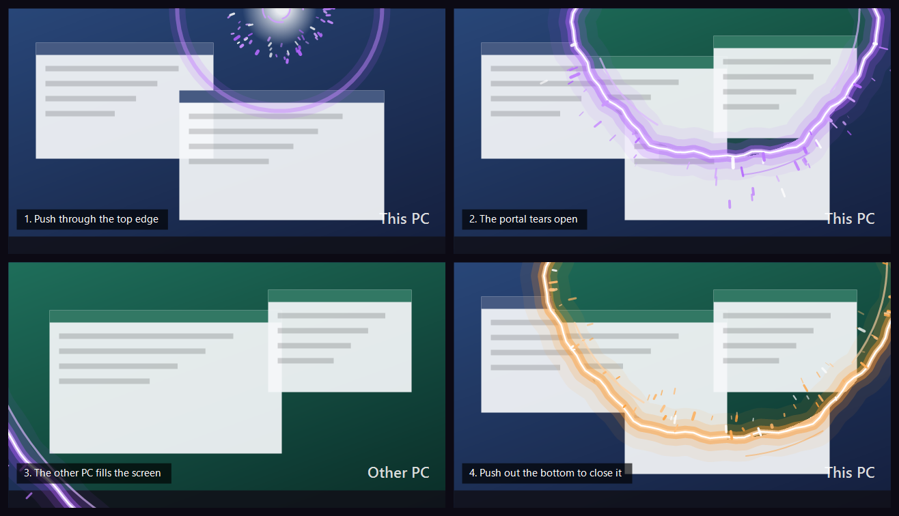
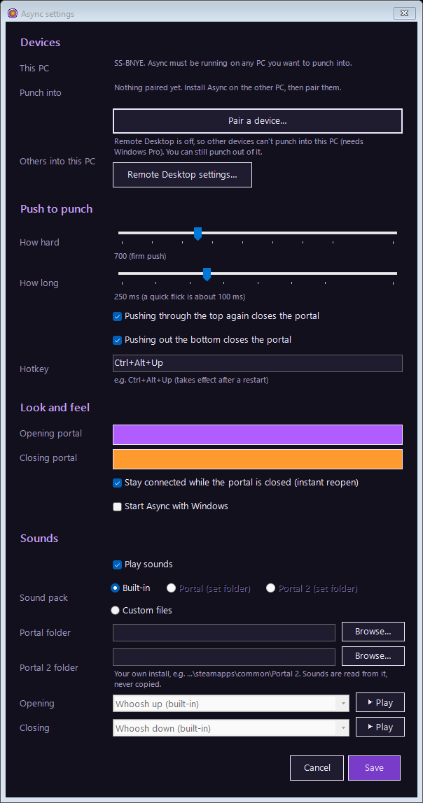

<p align="center">
  
</p>

<h1 align="center">Async</h1>

<p align="center"><b>Push your mouse through the edge of your screen and punch a portal into another computer.</b></p>



Async turns any monitor into a window onto another computer. Shove the mouse against the edge of a screen
and a portal tears open where you pushed, showing the other computer's desktop on that monitor. Push down out
of the bottom and it collapses back. The top and sides of each monitor can each lead to a different
computer: the top of your main screen to your desktop, the right side of your laptop screen to a Mac, and
so on.

Async runs on every computer you want to move between. The copies pair with a short code and then talk
through their own end-to-end encrypted tunnel. There's no account to make, no VPN to set up (Tailscale,
Hamachi…) and no ports to open on your router.

## Features

- **Pick an edge for each computer:** Settings shows your monitors as they're arranged; click the top or a
  side of a screen and choose which paired computer it opens. The bottom is always the way back. The
  remote desktop resizes itself to fit the monitor.
- **Deliberate pushes only:** resting at the edge, flicking past it, dragging a window to the top, or moving
  the camera in a game never triggers it. How hard and how long you push are adjustable.
- **Edge glow:** the edge lights up as you push, so you can feel the portal about to open.
- **Lands where you punched:** the other computer's cursor appears right under the spot you pushed through.
- **Windows, macOS and Linux:** punch out of any of them into a Windows PC, and into any of them from a
  Windows PC.
- **Multi-screen PCs:** punching into a PC with several screens shows one of them; slide to the next by
  pushing the side of the screen (Mac and Linux), and pick which screen each edge opens.
- **Pair with a code:** one PC shows `ABCD-EFGH`, you type it on the other, done.
- **Its own secure tunnel**, built on [iroh](https://github.com/n0-computer/iroh). Connections go direct
  between your computers when possible (through home routers via hole punching) and fall back to an
  encrypted relay when not. Only paired devices are let in.
- **Portal effects:** a crackling rim, vortex, shockwave and sparks, in colours you pick.
- **Sounds:** a built-in whoosh, the portal entry/exit/open/close sounds from your own copy of
  *Portal* or *Portal 2*, or any `.wav` files.
- `Ctrl+Alt+Up` (configurable) or double-clicking the tray icon opens the portal too.



## Getting started

Grab the download for each computer from the [latest release](https://github.com/CalvinRogersDoE/Async/releases/latest):

| Computer | Download | What it can do |
|---|---|---|
| Windows 10/11 | `Async-win-x64.zip`: unzip and run `Async.exe` | Punch into any of your computers, and be punched into |
| macOS (Apple Silicon or Intel) | `Async-macos-universal.tar.gz`: unpack and double-click **Install Async.command** | Punch into Windows PCs, and be punched into |
| Linux (x86-64 or ARM64, X11) | `Async-linux-x86_64.tar.gz` / `Async-linux-arm64.tar.gz`: unpack and run `./install.sh` | Punch into Windows PCs, and be punched into |

Each system runs programs built for it, so there's one download per system, all built from the same
code. **Mac and Linux, step by step: [docs/hosting.md](docs/hosting.md).**

On Windows:

1. Run `Async.exe` on the computers involved. It sits in the system tray.
2. On one computer: tray icon → **Pair a device…** → **Show a code**. On the other: **Pair a device…** →
   **Enter a code**.
3. In **Settings**, next to the computer you'll punch into, enter the Windows user to sign in as, then
   **Password…** (for a Mac or Linux computer, just the screen sharing password). It's kept in Windows
   Credential Manager on this PC only.
4. Under **Screen edges**, click the top or a side of a screen and pick that computer. Save.
5. Push your mouse hard through that edge.

Turn on **Start Async with Windows** on any computer you want to be able to reach while you're away from it.

### Requirements

| | |
|---|---|
| Computer you punch **from** | Windows 10 or 11, macOS, or Linux on X11. From a Mac or Linux computer you can punch into Windows PCs for now |
| Computer you punch **into** | **Windows** 10/11 Pro or Enterprise with Remote Desktop on (Settings → System → Remote Desktop), **macOS** with Screen Sharing on, or **Linux** with Remote Desktop (GNOME, KDE) or a VNC server. See [docs/hosting.md](docs/hosting.md) |
| Both | Async running, and an internet connection (or the same network) |

Today the remote screen is carried by each system's own screen sharing (Remote Desktop, or VNC for
Macs, which Async has a built-in viewer for), sent through Async's tunnel. Because
Async tunnels it, you can block Remote Desktop's port (3389) to the network entirely; the tunnel delivers it
locally. Windows Remote Desktop signs into the remote PC's account, so its own screen shows the lock screen
while you're connected; its programs keep running.

## Roadmap

- [x] Push-through trigger, portal effects, sound packs
- [x] Pairing codes and an encrypted peer-to-peer tunnel (iroh)
- [x] Remote Desktop through the tunnel
- [x] Punch into macOS (Screen Sharing over VNC) and Linux (Remote Desktop or VNC)
- [x] The edge glows as you push; the cursor lands where you punched through
- [x] Map edges to computers (top → desktop, right → laptop…)
- [x] Punching *out* of macOS and Linux (into Windows PCs)
- [ ] From macOS and Linux into other Macs and Linux computers; the edge glow on macOS and Linux
- [ ] Wayland on Linux
- [ ] Async's own screen streaming: one format on every system, and Windows Home as a host
- [ ] Terminal mode: punch into a Linux or macOS shell
- [ ] Installer and auto-update

## How it works

```
 This PC                                                      Other PC
┌──────────────────────────┐                     ┌──────────────────────────┐
│ Async.exe (tray, C#)     │                     │ Async.exe                │
│  edge watcher → portal   │                     │                          │
│  Remote Desktop control ─┼─► 127.0.0.2:port    │                          │
│           ▲              │        │            │                          │
│ async-core.exe (Rust)    │        ▼            │ async-core.exe           │
│  pairing · peers · tunnel├── iroh QUIC (E2EE) ─┼► only paired devices ──► │──► Remote Desktop (localhost:3389)
└──────────────────────────┘   direct or relayed └──────────────────────────┘
```

- **`app/`**: the Windows tray app (C#, WinForms). It watches raw mouse input for pushes against a screen
  edge (`EdgeWatcher.cs`) and looks up which computer that edge leads to (`EdgeMap.cs` is the picker). It
  draws the portal on a click-through overlay while growing the remote window's circular shape
  (`PortalFx.cs`, `App.cs`), and hosts Windows' Remote Desktop ActiveX control (`PortalForm.cs`) or its
  own VNC viewer (`VncView.cs`).
- **`desktop/`**: `async-desktop`, the macOS and Linux app (Rust). The same edge pushes and portal as on
  Windows: raw mouse motion from XInput2 (Linux) or a CoreGraphics event tap (macOS), a window cut to the
  opening circle (X11 Shape, or a Core Animation mask), and Remote Desktop through
  [IronRDP](https://github.com/Devolutions/IronRDP). It drives the async-core service over a local socket.
- **`core/`**: `async-core`, the part that runs on every machine (Rust). It holds the device identity, pairs
  devices, accepts tunnels from paired devices and opens tunnels into them. The app drives it with JSON
  lines over stdin/stdout (`core/src/control.rs`). It also works on its own, which is handy on headless
  machines: `async-core pair-host`, `pair-join CODE`, `peers`, `serve`, `tunnel PEER`.

**Pairing** needs no server of ours. Both sides derive a throwaway iroh identity from the code: the side
showing the code listens as that identity, and the other side finds it through iroh's normal address
lookup. Each then proves it knows the code with an HMAC bound to its real, permanent identity, which the
QUIC/TLS handshake already authenticates. After that the code is useless; devices remember each other's
public keys. Codes have about 39 bits of entropy and expire after 10 minutes.

## Building

Windows: the [.NET 10 SDK](https://dotnet.microsoft.com/download) and [Rust](https://rustup.rs).

```
cd core
cargo build --release
cd ../app
dotnet build -c Release
```

The app build copies `core/target/release/async-core.exe` next to `Async.exe` (pass
`-p:AsyncCoreExe=<path>` if your Cargo target folder is elsewhere). For a release:

```
dotnet publish app -c Release -r win-x64 --self-contained -p:PublishSingleFile=true -p:EnableCompressionInSingleFile=true -o dist
```

macOS and Linux: [Rust](https://rustup.rs) (and CMake, for the TLS library), then `cargo build --release`
in `core/` and `desktop/`. CI builds every download (`.github/workflows/build.yml`).

Developer helpers: `ASYNC_SLOWMO=6` slows the animations, `ASYNC_DEBUG=1` logs raw mouse input, `--demo`
opens the portal 1.2 s after launch, and `Async.exe --render-docs <folder>` redraws the README images and
the icon. Logs and settings live in `%APPDATA%\Async`.

## Credits

Made by HallucinatesTigers. The tunnel is [iroh](https://github.com/n0-computer/iroh) by n0, and the Mac and
Linux app's Remote Desktop is [IronRDP](https://github.com/Devolutions/IronRDP) by Devolutions (both
Apache-2.0/MIT).

*Portal* and *Portal 2* are trademarks of Valve Corporation. Async isn't affiliated with or endorsed by
Valve, ships none of Valve's files, and only reads the sounds from a copy of the game you own, if you point
it at one.

## License

[MIT](LICENSE)
